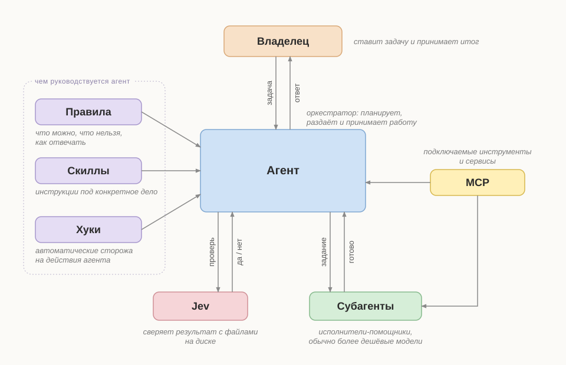

# claude-system

Личная система настройки Claude Code: правила, хуки, навыки, агенты и обёртки MCP-серверов, которые реально работают у владельца.
Это не пересказ, а копия живых файлов из `~/.claude`, выгруженная по белому списку с вычищенными личными данными.

[English below](#english)

## Как это устроено



Подробная схема со всеми скиллами, хуками и MCP: [docs/schema.svg](docs/schema.svg). В ней сплошная рамка — проверено, пунктир — на пробе.

Слова со схемы:
- **Владелец** — ставит задачу и принимает итог.
- **Агент** — главная сессия Claude: планирует, раздаёт работу, отвечает владельцу.
- **Субагенты** — помощники агента, которые выполняют задания: agy Flash, Claude Sonnet, Haiku.
- **Jev** — проверяющий: сверяет результат с файлами на диске.
- **Правила** — постоянные указания (`CLAUDE.md`, `rules/`): что можно, что нельзя, как отвечать.
- **Скиллы** — инструкции под конкретное дело; агент берёт нужную по названию.
- **Хуки** — автоматические сторожа: срабатывают на действия агента, напоминают или запрещают.
- **MCP** — подключаемые инструменты и сервисы. Сейчас это поиск по коду и документам, проверки, браузер, мост к OpenCode; список можно расширять.

Коротко:
1. Владелец ставит задачу. По желанию сначала превращает её в чёткое задание навыком `/brief` (с вопросами) или `/short-brief` (без вопросов).
2. Главная сессия Claude — руководитель: решает, пишет задания, раздаёт, принимает. Режимы `/orc` и `/super-orc` запрещают ей делать рутину самой.
3. Исполнители: agy Flash (Gemini Flash через сторож `agy-run`) — чтение, правки по готовой спеке, прогоны; Claude-субагент `worker` (Sonnet) — новая логика и дизайн; `Explore` (Haiku) — разведка.
4. Проверка: результат сверяется с файлами на диске (MCP `jev`, навык `self-check`), а не с отчётом исполнителя.
5. Вокруг всего — правила (`CLAUDE.md`, `rules/`) и хуки, которые на каждом шаге напоминают или блокируют: чтение кода в обход индекса, лишние соло-вызовы, расход контекста и лимитов.

## Что в репозитории

| Путь | Что это |
|---|---|
| `system/CLAUDE.md` | Главные инструкции: навигация по коду, делегирование, проверка, стиль ответов |
| `system/rules/` | Отдельные правила: понятный язык, команды PowerShell, пути в Git Bash, предупреждение о необратимом, ИИ-штампы |
| `system/hooks/` | Хуки, подключённые в настройках, и их библиотеки |
| `system/skills/` | Системные навыки: agy, brief, short-brief, orc, super-orc, handoff, readme, git-ship, self-check, no-regressions, model-advisor, grill-me, cache-warm, jcodemunch, jdocmunch |
| `system/agents/` | Субагенты: worker (Sonnet), Explore (Haiku), помощник брифа, opencode |
| `system/commands/` | Команды, в том числе `oc` (делегирование в OpenCode) |
| `system/mcp-wrappers/` | Обёртки запуска MCP-серверов (jev, jdocmunch) и мост к OpenCode |
| `system/output-styles/`, `system/statusline.js` | Стиль вывода и строка состояния |
| `system/design-library/ai-stamps.md` | Каталог ИИ-штампов, на который ссылаются правила |
| `system/settings.example.json` | Шаблон `settings.json`: пути заменены метками, секреты — `<REDACTED>` |
| `manifest.txt` | Белый список: что выгружается |
| `export.ps1`, `redact.txt` | Скрипт выгрузки и дополнительные замены личного (`redact.txt` локальный, в репозиторий не попадает) |
| `docs/` | Схема и рабочие заметки |

Метки в файлах: `<HOME>` — домашняя папка пользователя, `<VIBECODING>` — рабочая папка проектов, `<EMAIL>`, `<TELEGRAM_ID>`, `<REDACTED>` — вычищенные значения.

## Чего здесь нет (намеренно)

- Память, журналы сессий, доступы, ключи, расписания, `settings.local.json`, резервные копии.
- Рабочие навыки (kosmoseo, landing-page-builder, carousel, brevo-email): они для конкретной работы, не часть системы. На схеме показаны группой «Рабочие».
- AGY Switch и сторож `agy-run` — отдельный закрытый репозиторий `eivl10/agy-switch`.

## Что нужно, чтобы это работало

- Claude Code (десктоп или CLI), Windows, PowerShell 5.1, Git Bash, Node.js.
- MCP-серверы: jcodemunch (навигация по коду), jdocmunch (навигация по документации), jev (дешёвые проверки; ключ читается из переменной окружения пользователя).
- agy (Antigravity CLI, модель Gemini Flash) и сторож `agy-run` из `eivl10/agy-switch`.
- По желанию: OpenCode для команды `oc`.

## Как поставить

1. Скопировать содержимое `system/` в `~/.claude/` (сначала сделать резервную копию своей папки).
2. `settings.example.json` переименовать в `settings.json`, заменить метки `<HOME>`, `<VIBECODING>` своими путями, вернуть свои значения вместо `<REDACTED>`.
3. Подключить MCP-серверы и agy (см. выше), перезапустить Claude Code.

## Как обновить репозиторий

```powershell
& ".\export.ps1" -DryRun
& ".\export.ps1"
```
Затем проверка утечек и коммит — навыком `git-ship` («выложи систему»).

## Что проверено

Пометка берётся из реестра решений владельца: «подтверждённое» = проверено, остальное = на пробе (работает, но эффект не доказан).

Проверено:
- `/brief` и `/short-brief` — навыки брифа (подтвердил владелец 03.11.2026).
- Хук `block-get-file-content.ps1` — блокирует чтение файлов целиком (114 блокировок за 30 дней по аудиту).
- Сторож `agy-run` — останавливает зависшего исполнителя (живой прогон 3 из 3; лежит в `eivl10/agy-switch`).

Всё остальное — на пробе. Подробно по каждому элементу: [docs/statuses.md](docs/statuses.md).

---

## English

Personal Claude Code setup: rules, hooks, skills, sub-agents and MCP wrappers that are actually in use. These are copies of the live files from `~/.claude`, exported by a whitelist with personal data scrubbed.

**How it works** (see the diagram above; solid frame = verified, dashed = on trial):
1. The owner gives a task, optionally turned into a precise brief by `/brief` (asks questions) or `/short-brief` (no questions).
2. The main Claude session is the lead: decides, writes briefs, delegates, accepts. Modes `/orc` and `/super-orc` forbid it from doing routine work itself.
3. Executors: agy Flash (Gemini Flash behind the `agy-run` watchdog) for reading, spec-driven edits and runs; `worker` sub-agent (Sonnet) for new logic and design; `Explore` (Haiku) for scouting.
4. Verification against files on disk (`jev` MCP, `self-check` skill), not against an executor's report.
5. Rules (`CLAUDE.md`, `rules/`) and hooks wrap everything: they remind or block on each step.

**Contents:** `system/` holds the exported files (see the table above), `manifest.txt` is the whitelist, `export.ps1` + `redact.txt` do the export and scrubbing. Placeholders: `<HOME>`, `<VIBECODING>`, `<EMAIL>`, `<TELEGRAM_ID>`, `<REDACTED>`.

**Not included on purpose:** memory, session logs, credentials, schedules, `settings.local.json`, backups, work-specific skills; AGY Switch and `agy-run` live in a separate private repo `eivl10/agy-switch`.

**Requirements:** Claude Code, Windows, PowerShell 5.1, Git Bash, Node.js; MCP servers jcodemunch, jdocmunch, jev; agy (Antigravity CLI) with `agy-run`; optionally OpenCode.

**Install:** back up your `~/.claude`, copy `system/` into it, rename `settings.example.json` to `settings.json`, replace placeholders, connect MCP servers and agy, restart Claude Code.

**Verified:** `/brief`, `/short-brief`, hook `block-get-file-content.ps1`, the `agy-run` watchdog. Everything else is on trial; per-item list in [docs/statuses.md](docs/statuses.md).
